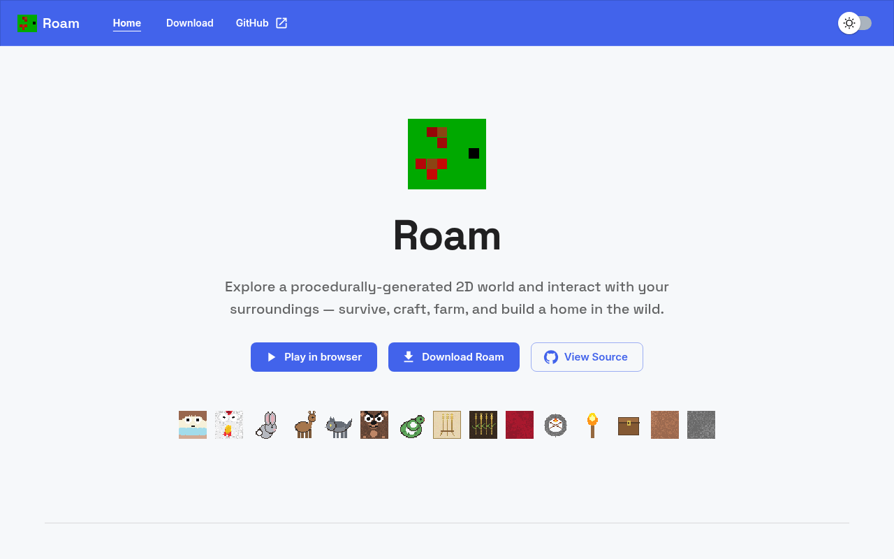
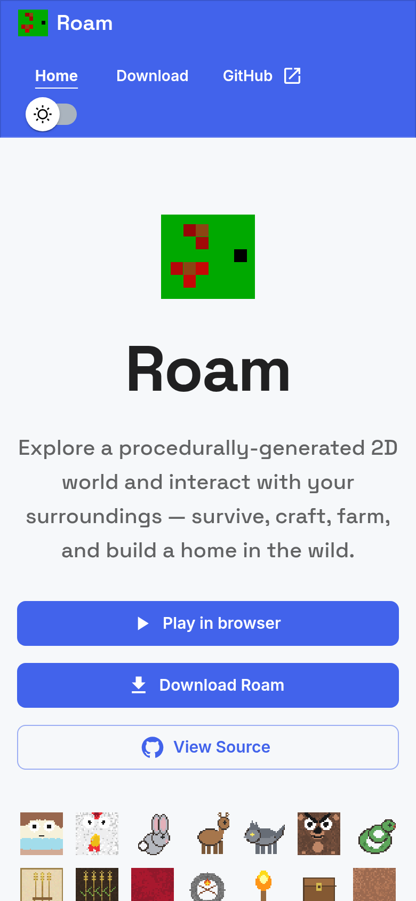
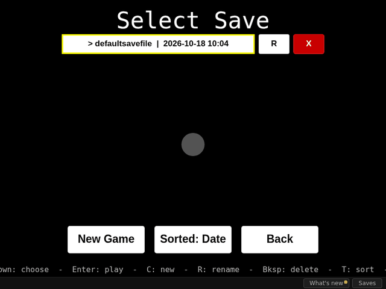

# Roam — Website

The marketing and download site for [**Roam**](https://github.com/Preponderous-Software/roam),
a free, source-available survival game by Preponderous Software where you explore a
procedurally-generated 2D world and interact with your surroundings.

<p align="center">
  
  
</p>
<p align="center"><em>The live site at <a href="https://roam.preponderous.org">roam.preponderous.org</a>, desktop and phone width.</em></p>

<p align="center">
  
</p>
<p align="center"><em>The <code>/play</code> page: the real game running in the browser via Pyodide.</em></p>

<sub>How these were captured: headless Chromium (Playwright) against the live site on 2026-10-18 at 1280×800 and 390×844; the GIF is a sequence of real screenshots of <code>/play</code> taken while WASD was held.</sub>

The site is a small [Next.js](https://nextjs.org/) + [MUI](https://mui.com/) app, built as
a sibling of [preponderous-dot-org](https://github.com/Preponderous-Software/preponderous-dot-org)
and [dansplugins-dot-com](https://github.com/Dans-Plugins/dansplugins-dot-com) — same theme,
color-mode toggle, chrome, and Docker/CI setup.

## What's on it

- **Home** (`/`) — hero (with a "Play in browser" link to `/play`), an at-a-glance feature grid,
  in-game screenshots, and a "how to play" panel (desktop, terminal/text mode, and in the browser).
- **Download** (`/download`) — platform cards linking to the latest GitHub release assets
  (Windows installer + portable zip, macOS `.dmg`, and run-from-source for Linux).
- **`/version.json`** — `{"version": "<version>"}`, the `package.json` version this build was made
  from, sent with `Cache-Control: no-store` so a deploy can be checked by the version it reports.
- **`/sitemap.xml`** — every indexable page (`SITEMAP_PATHS` in [`utils/site.ts`](utils/site.ts)) at
  the production origin; `public/robots.txt` points crawlers at it.

The game's own art (icon, sprites, screenshots) lives in `public/` and is shown on the site.

## Getting started

```bash
npm install      # first time only (a lockfile is committed)
npm run dev      # http://localhost:3000
```

## Scripts

| Command         | What it does                                  |
| --------------- | --------------------------------------------- |
| `npm run dev`   | Start the dev server on port 3000             |
| `npm run build` | Production build                              |
| `npm run start` | Serve the production build                     |
| `npm run lint`  | ESLint (`next lint`)                           |
| `npm test`      | Run the Vitest unit + component tests          |

## Keeping downloads current

The download buttons point at a specific Roam release. When a new version ships, bump
`LATEST_VERSION` in [`utils/site.ts`](utils/site.ts) — that one value drives every direct
asset link. See [CONFIG.md](CONFIG.md) for the full content/config reference.

## Deployment

Containerized like its sibling sites:

```bash
docker compose up --build   # serves on :3000
```

It is intended to deploy behind the Preponderous gateway nginx box alongside the other
Preponderous sites, served at `https://roam.preponderous.org` (`SITE_ORIGIN` in
[`utils/site.ts`](utils/site.ts)).

## Usage reporting

When the server is given a trace key in `USAGE_REPORTING_KEY`, it reports one `page-view` event per
HTML page it serves to [trace](https://trace.danielstephenson.dev), as the program `roam-website`,
carrying the page's path (for example `/download` — never a query string or fragment) and the site
version. Nothing about the visitor is sent: no IP address, user agent, cookie, session, account or
referrer. No script is added to any page — the report is made by the server (Next.js middleware),
so the key never reaches the browser — and crawlers, uptime monitors, prefetches, API calls,
assets and 404s are not counted.

Every page view also carries a random **installation ID** for the server (the tag `install`), so
trace can count installations of the site rather than raw events. It is a UUID made when the
server first reports, derived from nothing about the server or any visitor. `TRACE_INSTALL_ID`,
when set, is used as is; otherwise the client is pointed at
`$XDG_DATA_HOME/roam-website/trace-install-id` (or `~/.local/share/roam-website/trace-install-id`).
The report is made from Next.js middleware, which runs in the Edge runtime and has no file system,
so in practice the ID lives in memory for the life of the server process: each restart or redeploy
counts as a new installation unless `TRACE_INSTALL_ID` is set. To reset it, restart the server or
change `TRACE_INSTALL_ID` (or delete the file, where a runtime with file access created one). Every
switch below also stops it: with reporting off no ID is made, read or written.

Reporting is off unless a key is set, and any of these turns it off:

- `USAGE_REPORTING_ENABLED=false` in the server's environment (also `0`, `no`, `off`; case and surrounding
  space do not matter)
- `TRACE_USAGE_REPORTING=off` in the environment (also `false`, `0`, `no`; shared by every program
  that reports to trace, and it wins over the setting above)
- `DO_NOT_TRACK=1` in the environment (also `true`, `yes`; see
  [consoledonottrack.com](https://consoledonottrack.com))
- leaving `USAGE_REPORTING_KEY` unset

`USAGE_REPORTING_ENDPOINT` sends the reports to a different trace server. On the first request
its middleware sees (any path outside `/_next/` and `/api/` without a file extension), the server logs one line saying whether reporting is on and, if it is off, which switch
turned it off. The only case with no line is a missing key with none of the other switches set,
so a site that was never configured stays quiet. Details: https://github.com/Stephenson-Software/trace#usage-reporting

## License

[Preponderous Non-Commercial License](LICENSE).
